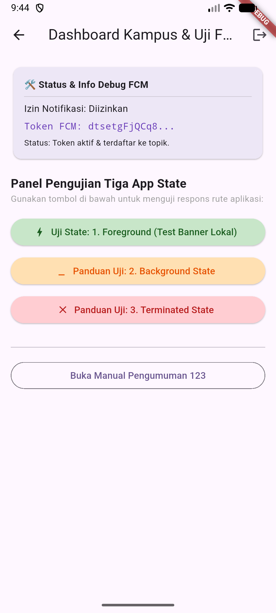
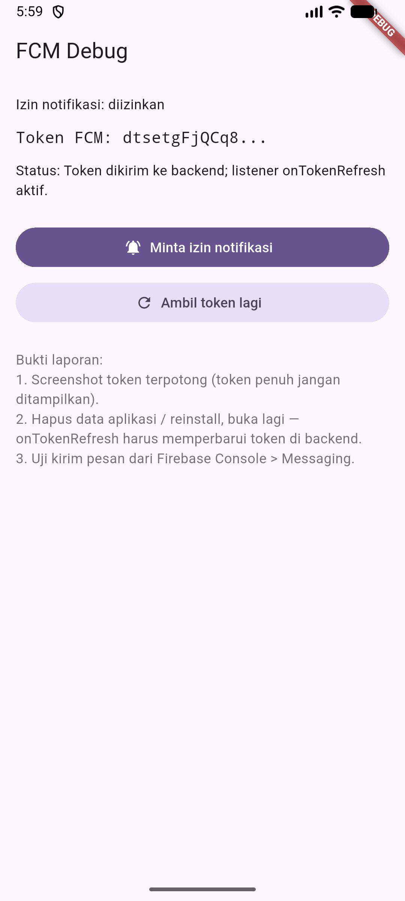
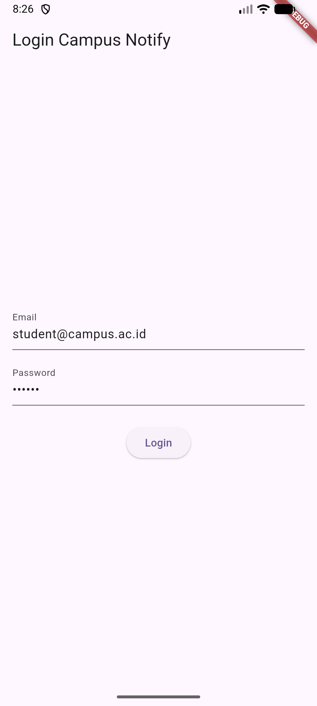
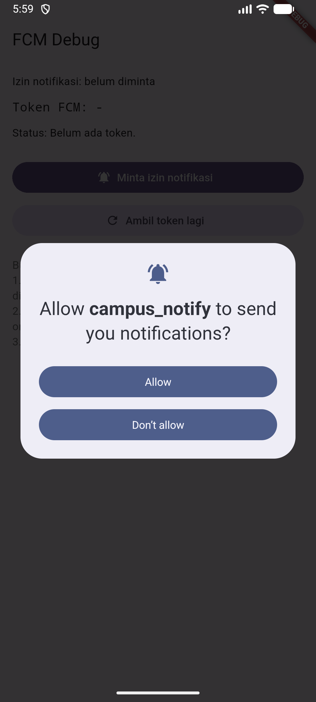
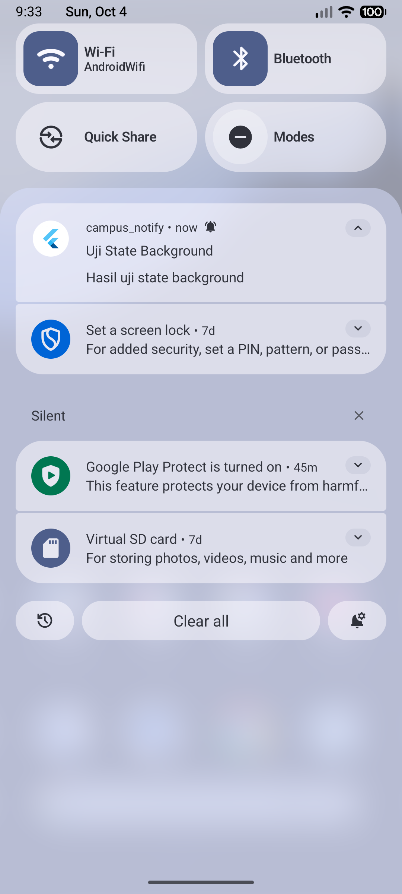
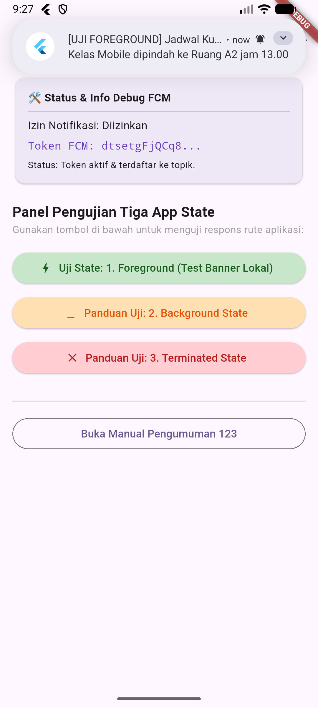
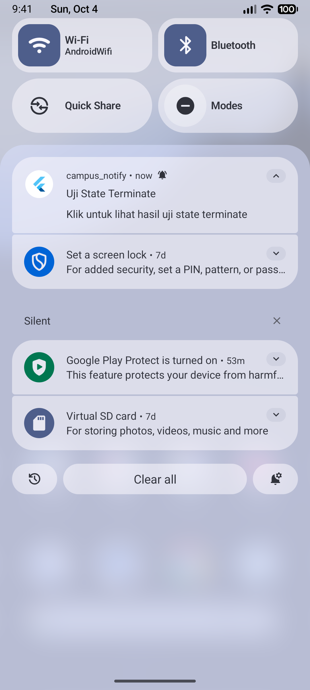
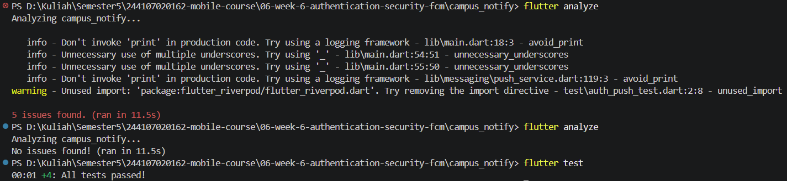
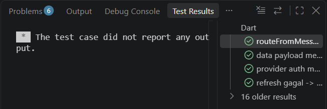

# 06 | Authentication, Security & FCM

---
## Tampilan
> 

---
## AI Verification Checklist

- [✓] Apakah background handler berupa fungsi top-level dengan @pragma('vm:entry-point')? (tolak jika berupa method kelas).
    = Ya. Fungsi dideklarasikan di luar kelas (top-level) dengan anotasi tersebut agar dapat dijalankan oleh sistem pada isolate terpisah saat aplikasi tertutup.
- [✓] Apakah onTokenRefresh benar-benar mengirim token baru ke backend, bukan hanya dicetak ke log?
    = Ya. Listener onTokenRefresh memanggil fungsi asinkron yang mengeksekusi request HTTP (_dio.post) untuk memperbarui token di server.
- [✓] Apakah foreground memakai local notification manual? (tanpa ini banner tidak muncul saat aplikasi terbuka).
    = Ya. Menggunakan flutter_local_notifications karena FCM secara default tidak menampilkan system banner secara otomatis saat aplikasi dalam kondisi aktif.
- [✓] Apakah klik dari ketiga state (foreground/background/terminated) masuk ke rute yang benar? Buktikan dengan tabel pengujian.
    = Ya. Ditangani secara komprehensif melalui callback banner lokal, onMessageOpenedApp, dan getInitialMessage yang meneruskan payload ke router.
- [✓] Apakah token/secret tidak di-hardcode dan tidak di-log penuh? Perbaiki bila AI melanggarnya.
    = Ya. Kredensial dimuat secara dinamis via opsi aman, dan token FCM ditampilkan terpotong (masked) untuk mencegah kebocoran data sensitif.
- Keputusan final Anda beserta alasannya, boleh berbeda dari rekomendasi AI selama berargumen.
    = Sebagai keputusan final, saya memilih untuk menggunakan pendekatan fungsi modular terpusat (top-level functions) di dalam file push_service.dart. Keputusan ini diambil karena strukturnya paling sesuai dengan modul praktikum yang sedang saya pelajari, sehingga lebih mudah dipahami alurnya ketimbang langsung menggunakan arsitektur kelas yang terlalu kompleks.
    
---
## Checklist Verifikasi Mandiri

- [✓] Token hanya di flutter_secure_storage, tidak di SharedPreferences/log/screenshot penuh.
    > 

- [✓] 401 memicu refresh sekali lalu retry; refresh mati memaksa login ulang.
    > 
    > 

- [✓] Ketiga app state teruji dengan tabel bukti; klik masuk ke rute yang benar
    > 
    > 
    > 

- [✓] Topik untuk broadcast, token untuk pesan personal.

- [✓] flutter analyze bersih dan semua test lulus.
    > 
    > 

- [✓] Hasil AI diverifikasi dan didokumentasikan pada folder docs/. [docs](/06-week-6-authentication-security-fcm/docs/AI_Challenge.md)

---
## Refleksi

- Mengapa refresh token tidak boleh disimpan di SharedPreferences? Apa risikonya bila bocor?
    = Karena SharedPreferences menyimpan data dalam bentuk plaintext (tanpa enkripsi) yang mudah dibaca jika perangkat mengalami root atau dieksploitasi oleh aplikasi lain. Risikonya sangat tinggi karena refresh token memiliki masa aktif yang panjang; jika penyerang berhasil mencurinya, mereka dapat terus menerus menghasilkan access token baru untuk menyamar sebagai pengguna tanpa perlu memasukkan kata sandi lagi. Oleh karena itu, token harus disimpan di penyimpanan terenkripsi seperti flutter_secure_storage.
- Apa yang rusak bila onTokenRefresh diabaikan selama satu semester perkuliahan?
    = Jika diabaikan, sistem backend kampus akan menyimpan token perangkat yang sudah kedaluwarsa, basi, atau berubah akibat pengguna melakukan reinstall aplikasi atau clear data. Akibatnya, notifikasi penting seperti pengumuman nilai, perubahan jadwal kuliah, atau informasi mendesak tidak akan pernah sampai (delivery failure) ke perangkat mahasiswa tersebut selama satu semester penuh.
- Kapan memakai topik dan kapan memakai token perangkat? Beri contoh pesan kampus untuk masing-masing
    = Topik digunakan untuk pengiriman pesan massal atau penyiaran (broadcast) ke sekelompok orang sekaligus tanpa harus melacak token individual. Contohnya, "Pengumuman libur nasional untuk seluruh mahasiswa angkatan.". 
    Sedangkan, Token Perangkat digunakan untuk pesan yang bersifat personal, rahasia, atau spesifik hanya untuk satu pengguna tertentu. Contohnya, "Tagihan SPP semester ini telah terverifikasi, silakan cek detail nilai Anda.".
- Bagian mana dari rekomendasi AI yang Anda tolak, dan mengapa?
    = Saya menolak struktur awal draf AI yang membungkus logika notifikasi ke dalam kelas instansiasi yang kaku dan terikat Riverpod. Saya memperbaikinya dengan mengubah fungsi-fungsi tersebut menjadi sekumpulan fungsi modular mandiri (top-level functions) di push_service.dart. Tujuannya agar struktur kode lebih sederhana, mudah dipahami dalam konteks pengembangan, serta memastikan penanganan background handler dan navigasi aman dari pelanggaran isolasi memori Flutter.
---