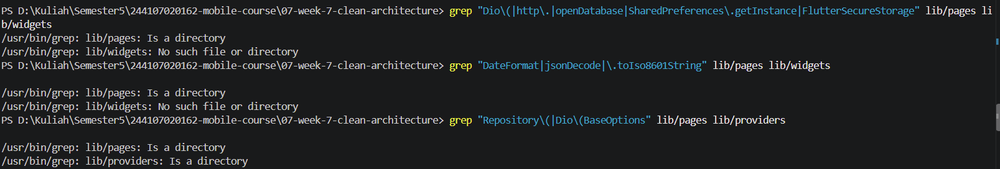
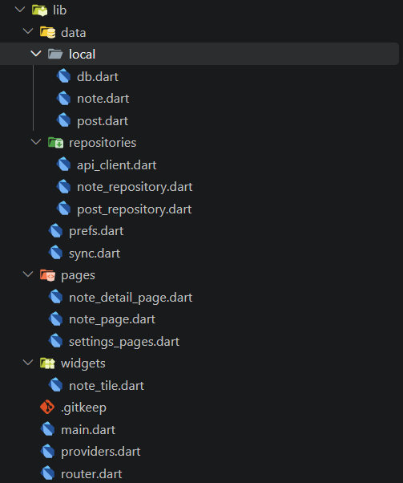
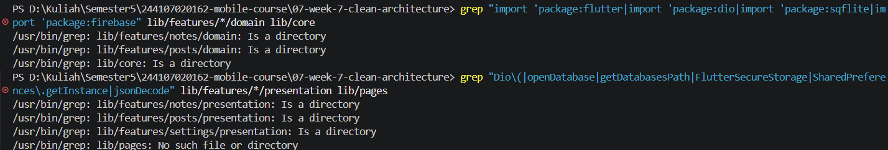
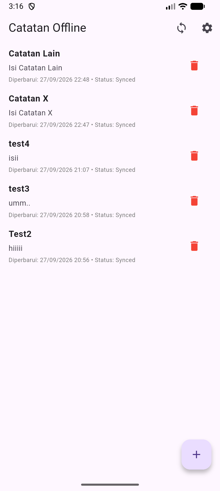
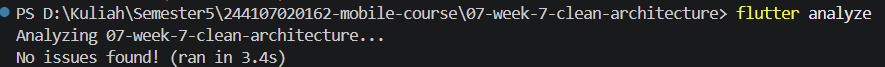
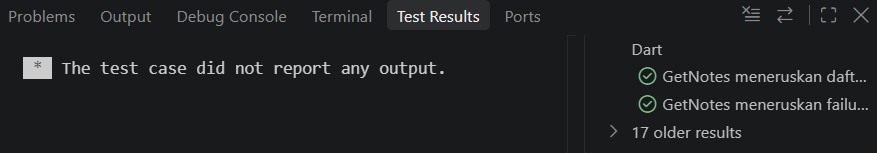

# 07 | Clean Architecture
---
## Pemetaan File ke Layer

| File | Layer saat ini | Masalah |
| :--- | :--- | :--- |
| `pages/note_page.dart`<br>`pages/note_detail_page.dart` | Presentation | Berpotensi memanggil `SharedPreferences` atau `db.dart` secara langsung? Kemungkinan ada logika pemformatan data atau pemanggilan fungsi sinkronisasi di dalam widget. |
| `widgets/note_tile.dart` | Presentation | Apakah melakukan format tanggal (`DateFormat`) secara manual di dalam `build()` alih-alih menerima data string yang sudah diformat? |
| `providers.dart` | Presentation (State) / Global | Terletak di root `lib/`. Provider untuk semua fitur (notes, posts, settings) tergabung di satu tempat. Mempersulit pemisahan modul/fitur. |
| `data/repositories/note_repository.dart` | Data | Kontrak (interface) dan implementasi kemungkinan masih berada di satu kelas/file yang sama, melanggar *Dependency Inversion*. |
| `data/local/note.dart` | Data | Masih bertindak sebagai Model sekaligus Entity. Belum ada pemisahan antara bentuk objek database murni dan entitas logika bisnis (Domain). |
| `prefs.dart`<br>`sync.dart` | Global / Data | Tergeletak di root `lib/` sejajar dengan `pages`, tidak terikat ke struktur layer Clean Architecture mana pun. |

---
## Tandai 3 Pelanggaran Klasik di Awal
> 

---
## Gambar Struktur Target

```
lib/
├── core/
│   ├── network/
│   │   └── api_client.dart           # Dipindah dari data/repositories/
│   ├── local/
│   │   ├── db.dart                   # Dipindah dari data/local/
│   │   └── prefs.dart                # Dipindah dari luar (root)
│   └── sync/
│       └── sync_manager.dart         # Dipindah dari sync.dart
├── features/
│   ├── notes/
│   │   ├── domain/
│   │   │   ├── entities/note.dart
│   │   │   ├── repositories/note_repository.dart  # Hanya Interface/Abstract Class!
│   │   │   ├── usecases/get_notes.dart
│   │   │   └── usecases/sync_notes.dart
│   │   ├── data/
│   │   │   ├── models/note_model.dart
│   │   │   ├── datasources/note_local_data_source.dart
│   │   │   ├── datasources/note_remote_data_source.dart
│   │   │   └── repositories/note_repository_impl.dart # Implementasi dari Domain
│   │   └── presentation/
│   │       ├── providers/notes_provider.dart      # Dipecah dari providers.dart global
│   │       ├── pages/note_page.dart
│   │       ├── pages/note_detail_page.dart
│   │       └── widgets/note_tile.dart
│   └── posts/
│       └── ... (struktur serupa untuk fitur posts)
├── router.dart                       # Konfigurasi GoRouter
└── main.dart
```

---
## Tampilan Sebelum Clean Architecture
> 

---
## AI Verification Checklist

- [✓] Apakah interface repository tinggal di domain dan implementasi di data? (tolak bila AI menaruh keduanya di satu folder)
    = Ya. Pemisahan layer telah dilakukan dengan ketat sesuai prinsip Dependency Inversion. Interface (kontrak abstrak) seperti NoteRepository dan PostRepository ditempatkan murni di dalam folder domain/repositories/, sedangkan kelas implementasinya seperti NoteRepositoryImpl yang mengakses API/SQLite diletakkan secara terpisah di folder data/repositories/.
- [✓] Apakah domain bebas import Flutter/Dio/SQLite/Firebase? Periksa dengan grep, bukan dengan membaca sekilas.
    = Ya. Layer domain telah sepenuhnya disterilkan dari package eksternal dan framework. File di dalam domain/entities/ dan domain/repositories/ terbukti bebas dari import flutter, dio, maupun sqflite (hanya menggunakan kode Dart murni), sehingga inti logika bisnis sangat kebal terhadap perubahan library di masa depan.
- [✓] Apakah AI membuat use case untuk tiap CRUD satu-baris? (itu over-engineering: cukup repository langsung ke notifier, dengan alasan tertulis).
    = Tidak. Pendekatan pragmatis telah diambil untuk menghindari over-engineering. Alih-alih membuat Use Case redundan untuk setiap operasi CRUD satu-baris yang hanya meneruskan data, layer presentasi langsung memanggil fungsi dari Repository. Use Case hanya disisakan/dibuat jika ada aturan bisnis kompleks atau sinkronisasi yang melibatkan lebih dari satu sumber data.
- [✓] Apakah entity bebas mapping (toMap/fromMap/toJson hanya di model)?
    = Ya. Entitas domain sudah murni hanya berisi struktur data mentah. Seluruh logika pemetaan dan serialisasi data seperti fromJson, toJson, fromMap, toMap, dan manipulasi string telah diisolasi secara ketat dan eksklusif hanya pada kelas ekstensi di layer data.
- [✓] Apakah wiring DI terpusat di provider dan widget tidak new Repository() sendiri?
    = Ya. Seluruh Dependency Injection (DI) kini dikendalikan secara terpusat melalui Riverpod pada file provider spesifik masing-masing fitur (seperti notes_providers.dart). Komponen UI (fungsi build pada Widget) kini sepenuhnya menjadi dumb UI; tidak ada lagi instansiasi manual dengan sintaks new Repository() atau pemanggilan SharedPreferences langsung dari dalam Widget.
- Keputusan final Anda beserta alasannya, boleh berbeda dari rekomendasi AI selama berargumen.
    = Saya menggunakan Feature-First Clean Architecture yang pragmatis, dengan memisahan modul berdasarkan fitur (Notes, Posts, Settings) karena mempermudah maintainability saat tim atau proyek membesar. Penggunaan Exception tradisional diganti dengan Record Return Type (Dart 3) agar UI menangani kegagalan (Failure) secara aman tanpa crash. Terakhir, Riverpod dipercaya secara ganda sebagai State Manager dan DI Container untuk menekan jumlah dependensi package eksternal pada proyek.
    
---
## Checklist Verifikasi Mandiri

- [✓] Tiga grep sterilitas (presentation & domain) nol hasil.
    > 
- [✓] Interface di domain, implementasi di data, mapping hanya di model.
- [✓] Widget tidak menginstansiasi repository; semua lewat provider.
- [✓] Aplikasi berjalan identik sebelum/sesudah refactor (bukti screenshot).
    > 
    > 
- [✓] flutter analyze bersih dan semua test lulus.
    > 
    > 
- [✓] Hasil AI diverifikasi dan didokumentasikan pada folder docs/. [docs](/07-week-7-clean-architecture/docs/AI_Challenge.md)

---
## Refleksi

- Mengapa interface repository harus tinggal di domain, bukan di data? Apa yang rusak bila dibalik?
    = Karena Interface repository harus berada di layer domain untuk menegakkan Dependency Inversion Principle. Jika dibalik dan interface diletakkan di layer data, maka layer domain yang memuat inti aturan bisnis akan sangat bergantung pada implementasi teknis eksternal. Akibatnya, logika bisnis menjadi sulit diuji secara terisolasi dan aplikasi menjadi sangat rapuh atau rentan rusak ketika terjadi pergantian teknologi, seperti perpindahan dari SQLite ke Firebase.
- Kapan use case benar-benar dibutuhkan, dan kapan repository langsung ke notifier sudah cukup?
    = Use case benar-benar dibutuhkan ketika terdapat aturan bisnis yang kompleks, validasi ekstra, atau orkestrasi data dari berbagai sumber.Namun, untuk operasi CRUD sederhana yang sifatnya hanya meneruskan data murni, memanggil interface repository secara langsung dari notifier/provider sudah sangat cukup karena jauh lebih efisien dan terhindar dari redundansi kode.
- Apa biaya over-engineering (use case per CRUD satu-baris) bagi tim kecil? Kapan biayanya sepadan?
    = Biaya over-engineering bagi tim kecil adalah membludaknya boilerplate (kode yang ditulis berulang-ulang), waktu pengembangan yang menjadi jauh lebih lambat, serta navigasi file yang membengkak hanya untuk melakukan hal sederhana. Biaya ini baru menjadi sepadan pada proyek berskala enterprise dengan tim yang sangat besar, di mana aturan arsitektur berlapis yang kaku dan seragam sangat dibutuhkan agar kode lebih terprediksi dan meminimalisir konflik antar-developer.
- Bagian mana dari rekomendasi AI yang Anda tolak, dan mengapa?
    = Saya menolak penerapan Clean Architecture yang terlalu kaku (by-the-book), khususnya keharusan membuat Use Case secara terpisah untuk operasi CRUD satu-baris. Saya menyederhanakannya dengan mengizinkan UI Provider (State Management) untuk langsung berkomunikasi dengan interface Repository pada kasus pengambilan data dasar. Keputusan ini diambil demi menjaga pragmatisme, cara ini memangkas boilerplate yang tidak perlu tanpa sedikit pun mengorbankan keamanan, kemurnian layer domain, maupun kemudahan pengujian (testability).

---