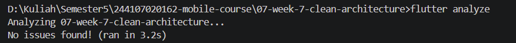
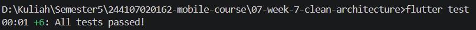
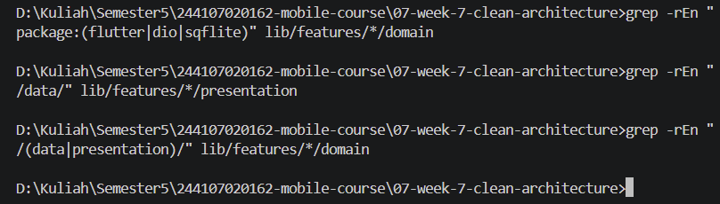

# 08 | Mid Project Review & Code Review

---
## Status Paruh Semester

Aplikasi catatan offline-first dengan feature-first Clean Architecture (Minggu 5-7). Minggu 8 tidak menambah fitur besar. Fokusnya fondasi: hygiene Git, PR kecil, static analysis, CI, dan review.

| Definisi selesai (mid review) | Status | Bukti |
| :--- | :---: | :--- |
| Aplikasi berjalan identik dengan akhir Minggu 7 | [✓] | `screenshots/tampilan-after.png` |
| `flutter analyze` bersih | [✓] | `screenshots/analyze.png` |
| `dart format --set-exit-if-changed lib test` rapi | [✓] | `screenshots/format.png` |
| `flutter test` hijau | [✓] | `screenshots/test.png` |
| Minimal 1 PR kecil per pasangan merge via review | [ ] | Menunggu review sejawat |
| README memuat status + peta issue/PR | [✓] | Dokumen ini |

---
## Peta Issue dan PR

| Issue | PR | Branch | Ringkasan | Base | Status |
| :--- | :--- | :--- | :--- | :--- | :--- |
| - | #1 | `develop` | Menyelaraskan `develop` (refactor struktur) | `main` | Merged |
| - | #2 | `feat/notes-validation` | `feat(notes): validasi judul kosong + test` | `main` | Merged |
| - | #3 | `style/dart-format` | `dart format lib test`, tanpa perubahan logika | `develop` | Merged |
| - | #4 | `chore/add-ci` | Workflow CI: format, analyze, test | `develop` | Merged (check `verify` merah) |
| - | #5 | `refactor/di-composition-root` | Repository dirakit di `main.dart` | `develop` | Merged (check `verify` merah) |
| - | #[nomor] | (PR review sejawat) | Menunggu | `develop` | Belum dibuat |

---
## Fitur Utama

- **Catatan offline (SQLite):** tambah, baca, hapus catatan. Penanda `dirty` untuk catatan yang belum tersinkron (`countDirty`, `markAllSynced`).
- **Validasi judul:** judul `null`, kosong, atau hanya spasi ditolak lewat `validateNoteTitle` dan use case `SaveNote`.
- **Posts dari API dengan cache SQLite:** online mengambil dari API, offline atau gagal jaringan memakai cache `cached_posts`.
- **Pengaturan:** mode gelap.

---
## Stack Teknologi

| Komponen | Teknologi |
| :--- | :--- |
| Framework | Flutter (Dart 3, record return type untuk hasil + `Failure`) |
| State dan DI | Riverpod |
| Navigasi | GoRouter |
| Penyimpanan lokal | SQLite (`sqflite`), `shared_preferences` |
| Jaringan | Dio (jsonplaceholder) |
| Kualitas kode | `flutter analyze`, `dart format`, `flutter test` |
| CI | GitHub Actions (`.github/workflows/ci.yml` di root repo) |

---
## Cara Menjalankan

```bash
git clone https://github.com/bavucadoz/244107020162-mobile-course.git
cd 244107020162-mobile-course/07-week-7-clean-architecture
flutter pub get
flutter run
```

```bash
flutter analyze
dart format --set-exit-if-changed lib test
flutter test
```

`dart format` dijalankan pada `lib test`, bukan `.`, karena di Windows folder `build/` memiliki path terlalu panjang dan membuat formatter crash.

---
## Static Analysis dan Grep Sterilitas

| Grep | Baseline | Setelah refactor DI (PR #5) |
| :--- | :--- | :--- |
| `domain` mengimpor flutter/dio/sqflite | kosong | kosong |
| `presentation` mengimpor `/data/` | 2 temuan: `notes_providers.dart:4`, `posts_providers.dart:10` | kosong |
| `domain` mengimpor data/presentation | kosong | kosong |

Tindak lanjut: provider repository di presentation kini bertipe interface domain dan melempar `UnimplementedError` bila tidak di-override. Implementasi dirakit di `main.dart`.

Baseline sebelum perbaikan: `flutter analyze` No issues found, `flutter test` +6 lulus.

> 
> 
> 

---
## Checklist Verifikasi Mandiri

- [✓] Branch dari `develop`, PR kecil satu tujuan, issue tertutup lewat `Closes #n`.
- [ ] Minimal 3 komentar review bermakna ditindaklanjuti sampai approve (menunggu review sejawat).
- [✓] `flutter analyze` bersih, `dart format` rapi, `flutter test` hijau, CI hijau.
- [✓] Tabel usulan AI vs keputusan final terdokumentasi di `docs/`.
- [ ] Tidak ada PR berstatus request changes yang di-merge.

---
## Hasil yang Dicapai

1. Riwayat Git diaudit, temuan dan tindak lanjutnya terdokumentasi.
2. Alur kerja baru: `develop` sebagai default branch, branch fitur kecil, commit konvensional, PR untuk setiap perubahan.
3. Validasi judul kosong dengan test (`validate_note_test.dart`) dan use case `SaveNote` dengan test (`save_note_test.dart`).
4. Pelanggaran dependency (presentation mengimpor data) ditemukan lewat grep dan diperbaiki dengan composition root di `main.dart`.
5. Bug nyata ditemukan lewat review AI dan dibuktikan sendiri: `save` belum terimplementasi padahal dipanggil use case, dan test hijau karena tidak ada test untuk `SaveNote`.
6. CI GitHub Actions (format, analyze, test) pada setiap PR. Check awal sempat merah karena [PENYEBAB DARI LOG CI] dan sudah diperbaiki.
7. Review AI terdokumentasi dengan pemisahan jelas antara saran dan keputusan sendiri.

---
## Refleksi

- Apa beda LGTM buta dengan approve yang bertanggung jawab? Apa risikonya bagi tim?
    = LGTM buta berarti approve karena diff tampak wajar, tanpa `checkout`, menjalankan kode, atau memeriksa jalur gagal. Approve yang bertanggung jawab berarti reviewer menarik branch, menjalankan `analyze` dan `test`, mencoba fitur manual, dan menulis komentar yang bisa ditindaklanjuti. Risikonya nyata di project ini: `save` melempar `UnimplementedError` padahal semua test hijau, sehingga reviewer yang hanya melihat centang hijau meloloskan crash. Contoh lain, PR #4 dan #5 ter-merge saat CI merah. Bagi tim, approve kosong memberi rasa aman palsu dan bug baru ketahuan setelah rilis.
- Kapan komentar wajib berstatus request changes, dan kapan cukup saran?
    = Request changes bila ada bug kebenaran (crash, data hilang, error path tak tertangani), pelanggaran dependency rule, perubahan perilaku tanpa test, atau CI merah. Cukup saran untuk penamaan, keterbacaan, dan alternatif desain. Urusan style diserahkan ke formatter.
- Bagian mana dari review AI yang Anda tolak atau sederhanakan, dan mengapa?
    = Saya menolak usulan mengubah `save` menjadi `Future<Failure?>` demi menyamakan gaya error. Perubahan itu menyentuh interface, implementasi, fake, use case, dan test, terlalu besar untuk PR kecil, dan perilaku sekarang sudah konsisten di dalam use case serta punya test. Saya mencatatnya sebagai issue lanjutan. Saya juga membatasi usulan `save` hanya pada insert, tanpa cabang update, agar PR tetap kecil.
- Satu hal konkret yang Anda perbaiki setelah review sejawat, apa dampaknya?
    = 
