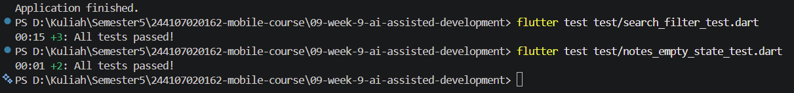
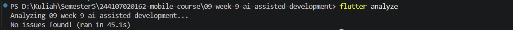
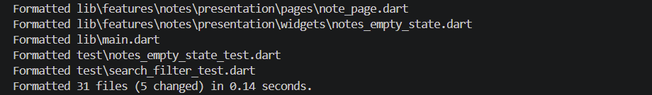
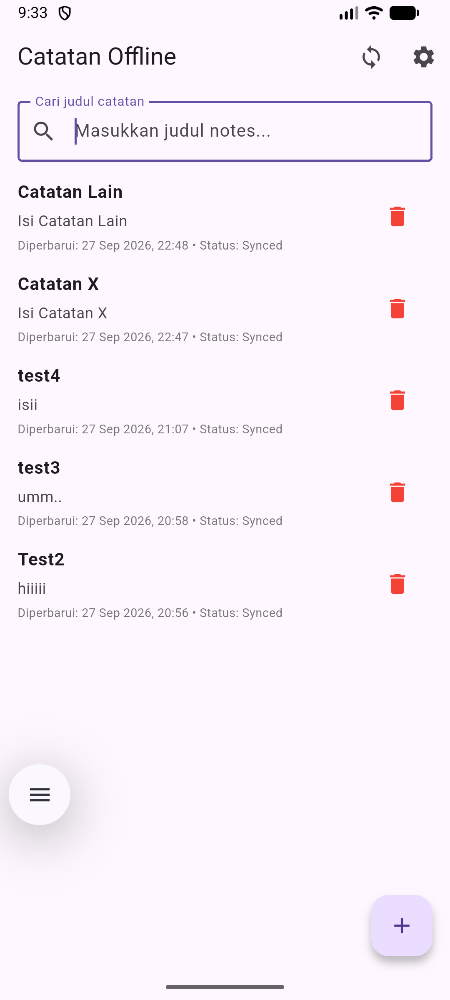
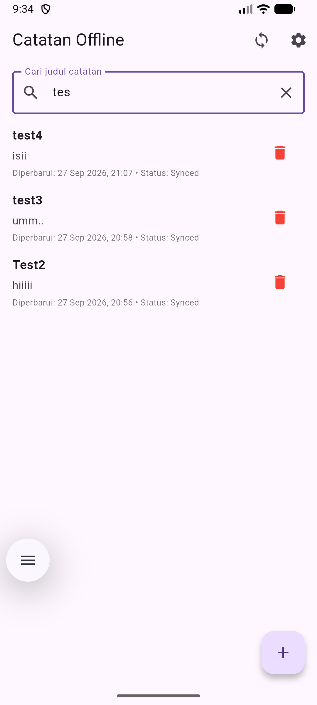
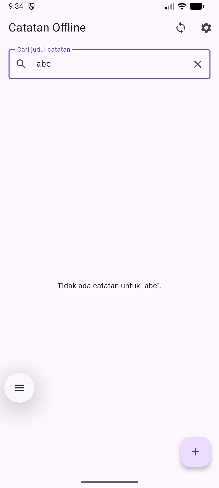

#  09 | AI-Assisted Development / Vibe Coding
---
## Fitur
Pencarian judul catatan di halaman **Catatan Offline**:
- Pencarian tidak membedakan huruf besar/kecil.
- Spasi di awal/akhir query diabaikan.
- Query kosong menampilkan semua catatan.
- Hasil tidak ditemukan menampilkan empty state.
- Filter dipisahkan ke fungsi domain murni agar mudah diuji.
---
## Stack dan arsitektur
Flutter, Riverpod, SQLite melalui repository. Pencarian mengikuti pemisahan `presentation -> domain <- data`; fungsi filter tidak mengakses database.
---
## File yang ditambahkan/diubah
- `lib/features/notes/domain/usecases/search_notes.dart` — aturan filter.
- `lib/features/notes/presentation/pages/note_page.dart` — input search dan daftar hasil.
- `lib/features/notes/presentation/widgets/notes_empty_state.dart` — empty state terpisah.
- `test/search_filter_test.dart` — unit test pencarian.
- `test/notes_empty_state_test.dart` — widget test empty state.
- `docs/ai-log.md` — prompt, konteks, output awal, bukti temuan, keputusan review, refleksi.
---
## Cara menjalankan

```bash
flutter pub get
flutter test test/search_filter_test.dart
flutter test test/notes_empty_state_test.dart
flutter analyze
dart format --set-exit-if-changed .
flutter test
```
---
## Hasil Menjalankan
> 
> 
> 
> 

---
## Uji manual
1. Query kosong — seluruh catatan tampil.
    > 
2. Query `tes` — judul yang mengandung “tes” tampil tanpa membedakan kapitalisasi.
    > 
3. Query `abc` — empty state hasil pencarian tampil.
    > 


