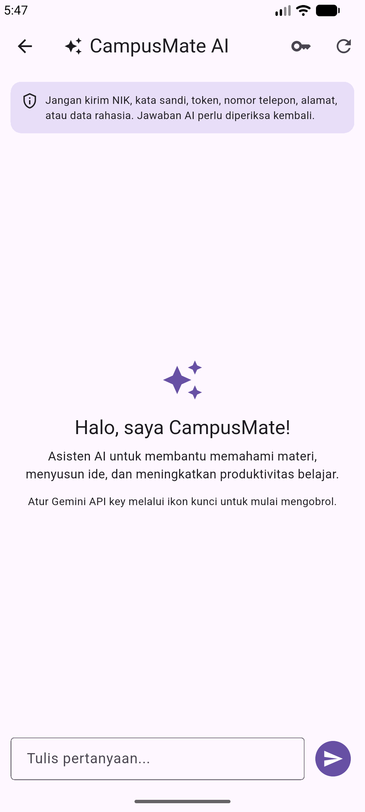
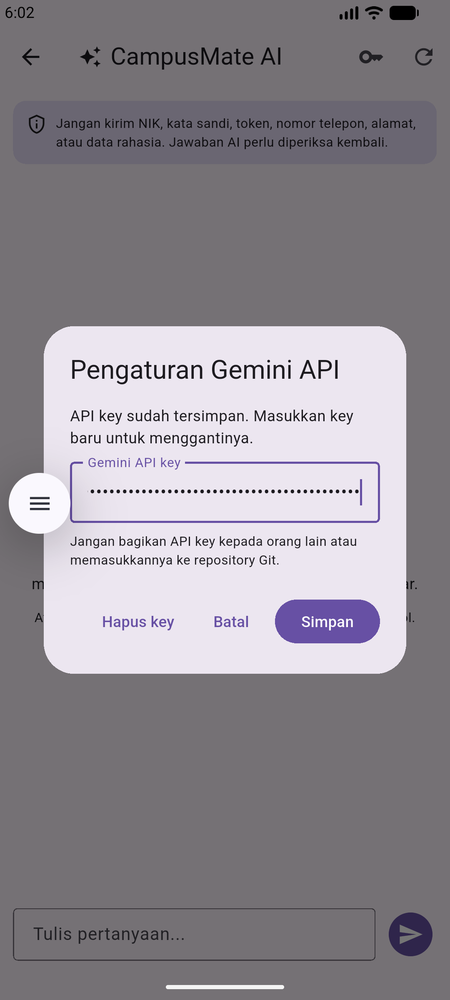
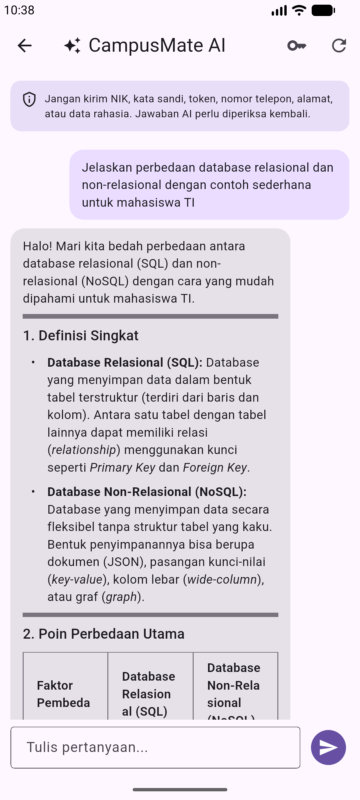
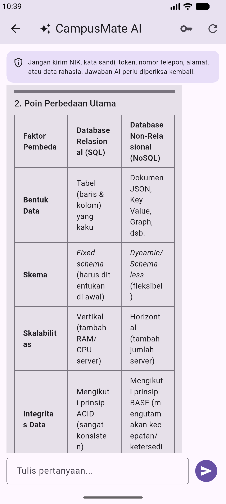
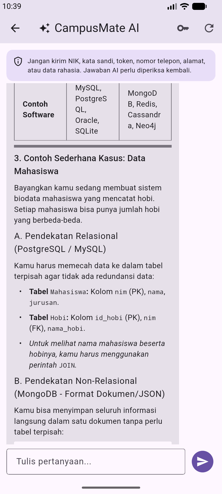
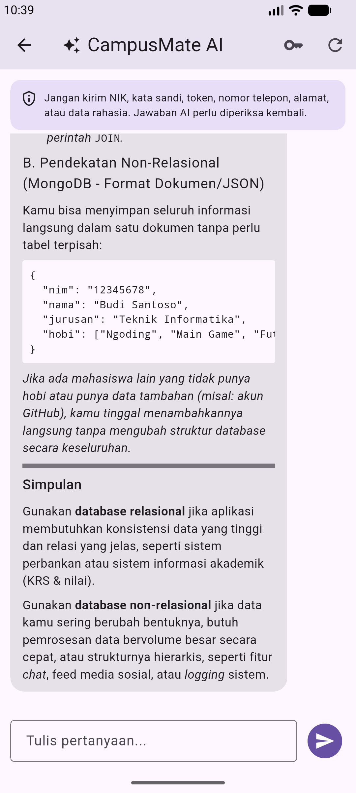
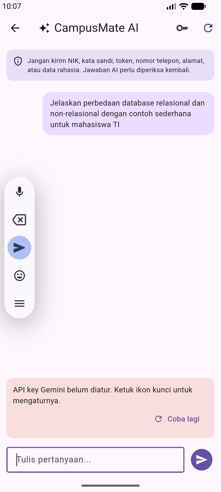
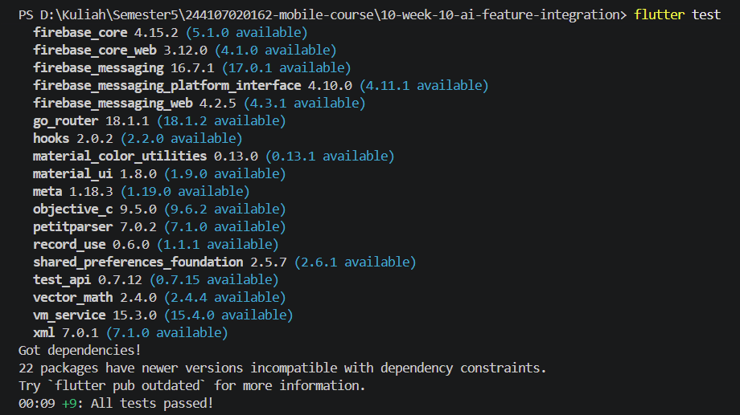
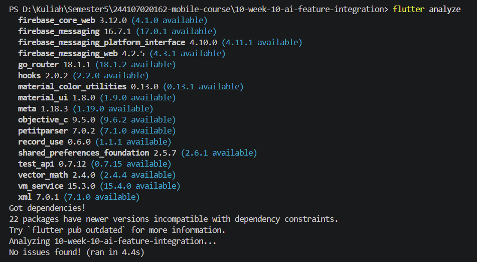

# 10 | AI Feature Integration

---

## 1. Fitur yang diintegrasikan

CampusMate AI adalah chat assistant berbahasa Indonesia untuk membantu mahasiswa memahami konsep, mengembangkan ide, dan meningkatkan produktivitas belajar.

Fitur utama:

- Chat dengan Gemini melalui endpoint `streamGenerateContent` (Server-Sent Events).
- Respons ditampilkan bertahap ketika chunk diterima, disertai indikator loading.
- API key dapat disimpan, diganti, dan dihapus dari halaman chat.
- API key disimpan melalui `flutter_secure_storage`, bukan di source code atau `SharedPreferences`.
- Terdapat batas input 2.000 karakter, maksimal 12 pesan riwayat yang dikirim, dan maksimal 512 output tokens per request.
- Pesan error dan tombol coba lagi disediakan ketika API atau koneksi bermasalah.
- Banner privasi mengingatkan pengguna agar tidak mengirim data pribadi.
- Chat dapat dibuka dari ikon AI pada halaman Catatan.

AI tidak membaca catatan SQLite, data akun, token Firebase, maupun informasi pribadi pengguna. Hanya teks yang sengaja diketik pada halaman chat yang dikirim ke Gemini.

---

## 2. Stack dan dependensi

Fitur memakai package yang sudah tersedia di `pubspec.yaml` proyek:

| Package | Pemakaian |
|---|---|
| `flutter_riverpod: ^3.4.3` | State dan dependency injection |
| `dio: ^5.11.1` | HTTP request dan SSE streaming |
| `flutter_secure_storage: ^11.2.0` | Penyimpanan API key terenkripsi |

---

## 3. Prompt design

**System prompt:**

> Kamu adalah CampusMate, asisten belajar dan produktivitas kampus yang ramah. Jawab dalam Bahasa Indonesia dengan jelas, ringkas, dan terstruktur. Bantu pengguna memahami materi, merangkum konsep, menyusun ide, dan mengelola produktivitas belajar. Jangan mengarang jadwal, kebijakan, nilai, atau informasi resmi kampus yang tidak diberikan. Jangan meminta atau mengungkap NIK, kata sandi, token, nomor telepon, alamat, maupun data pribadi. Jika pertanyaan membutuhkan informasi resmi kampus yang tidak tersedia, arahkan pengguna untuk memeriksa kanal resmi kampus.

**Contoh user prompt:**

> Jelaskan perbedaan database relasional dan non-relasional dengan contoh sederhana untuk mahasiswa TI.

**Contoh bentuk output awal yang diharapkan:**

> Database relasional menyimpan data dalam tabel yang saling terhubung menggunakan relasi atau kunci, contohnya PostgreSQL dan MySQL. Database non-relasional menyimpan data dalam bentuk yang lebih fleksibel seperti dokumen atau key-value, contohnya MongoDB. Pilihannya bergantung pada struktur data dan kebutuhan aplikasi.

---

## 4. Risiko dan mitigasi

| Risiko | Mitigasi pada implementasi / rekomendasi |
|---|---|
| API key bocor dari source code | Tidak ada key hard-coded; disimpan dengan `flutter_secure_storage`; dikirim lewat header, bukan URL. |
| API key diekstrak dari aplikasi/perangkat yang telah dikompromikan | Secure storage melindungi key saat tersimpan, tetapi tidak menjadikannya mustahil diekstrak dari aplikasi klien. Untuk produksi, pindahkan panggilan Gemini ke backend/proxy dan batasi key berdasarkan kebutuhan. |
| Data pribadi terkirim ke penyedia AI | UI menampilkan peringatan; system prompt melarang meminta data pribadi; aplikasi tidak menyertakan isi notes atau data akun pada payload. Pengguna tetap harus menghindari pengetikan data sensitif. |
| Biaya atau kuota meningkat | Input dibatasi 2.000 karakter, riwayat request maksimal 12 pesan, output maksimal 512 token. Tambahkan kuota per pengguna/hari di backend untuk deployment produksi. |
| API error, koneksi putus, atau kuota habis | UI menampilkan pesan fallback dan tombol coba lagi. Catatan lokal tetap dapat digunakan secara offline. |
| Jawaban AI tidak akurat | System prompt melarang mengarang informasi kampus; UI mengingatkan pengguna memeriksa kembali jawaban; informasi resmi harus diverifikasi ke kanal kampus. |
| Prompt terlalu panjang | Batasi panjang input dan jumlah pesan yang dikirim pada setiap request. |

---

## 5. Bukti pengujian dan screenshot

1. `ai-chat-empty.png` — halaman CampusMate AI sebelum percakapan.
  > 
2. `ai-api-key-settings.png` — dialog pengaturan API key dengan key tidak terlihat.
  > 
3. `ai-chat-streaming.png` — pesan pengguna dan respons AI yang sedang/selesai ditampilkan.
  > 
  > 
  > 
  > 
4. `ai-error-fallback.png` — tampilan fallback ketika API key tidak diatur atau koneksi gagal.
  > 
5. `flutter-test` — hasil flutter test.
  > 
6. `flutter-analyze` — hasil flutter analyze.
  > 

---

## 6. Refleksi

- Fitur AI mana yang Anda integrasikan dan mengapa?
  = Saya mengintegrasikan CampusMate AI berupa chat assistant berbasis Gemini. Fitur ini dipilih karena relevan dengan aplikasi kampus dan dapat membantu mahasiswa memahami materi, menyusun ide, serta meningkatkan produktivitas belajar. Implementasinya juga dapat memanfaatkan Dio, Riverpod, dan `flutter_secure_storage` yang sudah tersedia pada proyek.

- Bagaimana Anda melindungi privasi pengguna saat menggunakan AI API?
  = Dengan cara API key tidak ditulis langsung di source code atau SharedPreferences, tetapi disimpan menggunakan `flutter_secure_storage` dan dikirim melalui header HTTPS `x-goog-api-key`. Aplikasi juga harus menampilkan peringatan agar pengguna tidak mengirim NIK, kata sandi, token, nomor telepon, alamat, atau data pribadi lainnya.

- Fallback apa yang Anda sediakan jika layanan AI error?
  = Ketika API key belum diatur, koneksi terputus, kuota habis, atau layanan AI gagal memberikan respons, aplikasi menampilkan pesan fallback dan tombol coba lagi. Pengguna masih dapat kembali menggunakan fitur catatan lokal yang tidak bergantung pada layanan AI.

- Satu hal yang Anda pelajari tentang UX fitur AI di mobile?
  = Fitur AI perlu memberikan umpan balik yang jelas selama proses permintaan berlangsung. Karena itu, respons ditampilkan secara streaming agar pengguna dapat melihat teks secara bertahap, dilengkapi indikator loading, peringatan privasi, dan pesan error yang mudah dipahami. UX AI tidak cukup hanya menampilkan hasil akhir, tetapi juga harus membuat pengguna memahami status proses dan batas kemampuan sistem.