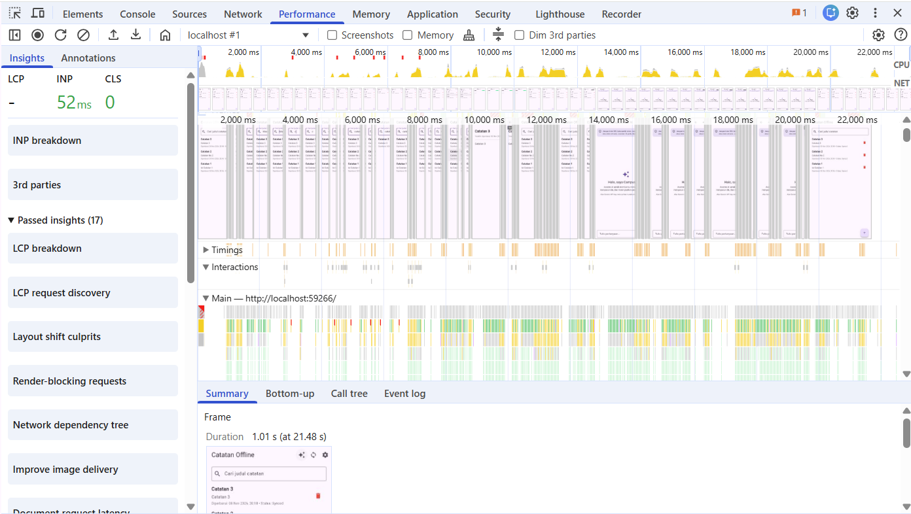
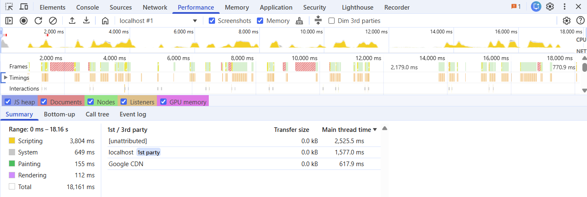

# 11 | Performance Optimization 
---

## Dokumentasi

- [Temuan source code](docs/performance-findings.md)
- [Laporan dan refleksi](docs/performance-report.md)
- Before Profile:
    > 
- After Profile:
    > 
    
---

## Refleksi

- Optimasi mana yang memberikan dampak terbesar dan mengapa?
    = Optimasi yang paling berpotensi berdampak adalah penggunaan Riverpod `select` dan pemisahan widget pada halaman AI. Respons Gemini diterima secara streaming sehingga state percakapan berubah berkali-kali. Sebelum optimasi, halaman utama mengamati seluruh state dan berpotensi membangun ulang bagian UI yang tidak berubah. Setelah optimasi, perubahan daftar pesan diproses oleh consumer daftar pesan, sedangkan tombol, error banner, dan composer mengamati properti masing-masing. Dampak terbesarnya tetap harus dikonfirmasi lewat perbandingan Flame Chart dan frame time.

- Bagaimana anda memverifikasi bahwa optimasi benar-benar bekerja?
    = Jalankan skenario yang sama pada mode profile dan perangkat yang sama sebelum serta sesudah optimasi. Bandingkan frame merah/kuning, rata-rata frame time, jank count, serta event build di Flame Chart. Pastikan update streaming terutama memicu consumer daftar pesan. Untuk memori, bandingkan Heap Snapshot setelah garbage collection pada urutan navigasi yang sama.

- Trade-off apa yang anda hadapi?
    = Pemisahan widget dan selector menambah jumlah class/widget serta sedikit kompleksitas struktur kode. `RepaintBoundary` dapat menambah layer dan penggunaan memori, sehingga hanya dipasang pada area percakapan, bukan secara berlebihan pada setiap elemen. Daftar pesan tetap perlu diperbarui ketika chunk baru tiba karena konten jawaban memang berubah.

- Kapan sebaiknya optimasi premature dihindari?
    = Optimasi premature sebaiknya dihindari sebelum ada baseline dan bukti bottleneck. Jangan menambah cache, pagination, isolate, atau dependency hanya karena terlihat lebih canggih. Mulai dari profiling, pilih masalah yang paling berpengaruh terhadap pengalaman pengguna, lakukan satu perubahan terukur, lalu ulangi pengujian.

