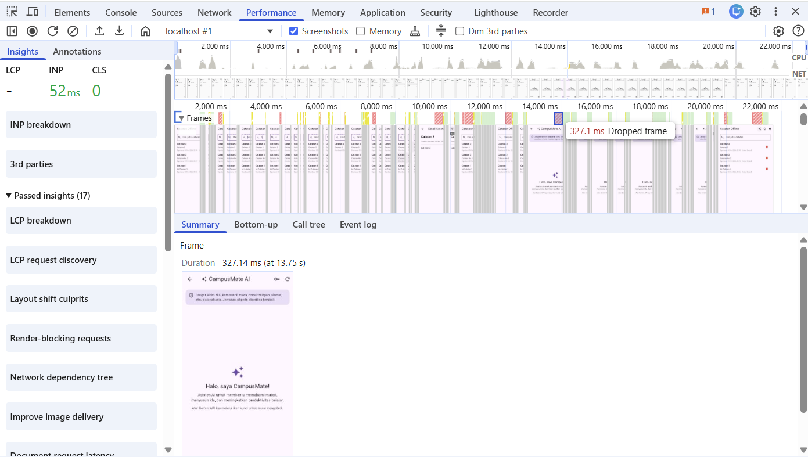

# Performance Report — Campus Notify

---

## 1. Baseline Metrics (Before)

| Metrik | Baseline |
|---|---:|
| Jumlah frame merah | **12** |
| Jumlah frame kuning | **> 70** |
| Frame time (ms) | **22,588 ms** |
| Memory Usage (MB) | **50,4MB** |

---
## 2. Temuan dari profiling

Berdasarkan hasil profiling menggunakan Flutter DevTools, ditemukan indikasi permasalahan performa pada aplikasi campus_notify. Terdapat 12 frame merah dan lebih dari 70 frame kuning yang menunjukkan adanya frame dengan waktu pemrosesan relatif tinggi. Temuan tersebut menunjukkan bahwa proses eksekusi kode aplikasi perlu diperiksa lebih lanjut untuk mengidentifikasi kemungkinan penyebab keterlambatan pemrosesan frame.

  > 

---
## 3. Optimasi yang Diterapkan

### A. Riverpod `select`

Di `ai_chat_page.dart`, bagian tombol percakapan, daftar pesan, error banner, dan composer kini hanya membaca properti state yang dibutuhkan, misalnya:

```dart
final messages = ref.watch(
  aiChatControllerProvider.select((state) => state.messages),
);
```

Sebelumnya halaman utama membaca seluruh `AiChatState`. Karena jawaban AI dikirim secara streaming dan state berubah untuk setiap chunk, seluruh `Scaffold` berpotensi ikut rebuild. Setelah perubahan, update `messages` hanya memicu consumer daftar pesan; `isLoading` dan `errorMessage` diamati secara terpisah.

### B. Ekstraksi widget

Komponen privacy notice, daftar pesan, error banner, composer, dan tombol percakapan baru dipisahkan menjadi widget kecil. Hal ini membuat batas tanggung jawab dan area rebuild lebih jelas.

### C. `RepaintBoundary`

`RepaintBoundary` ditempatkan di sekitar area percakapan yang dapat di-scroll. Tujuannya memisahkan repaint list dari privacy notice dan composer yang tetap. Boundary tidak ditambahkan untuk setiap baris karena `ListView.builder` sudah menerapkan repaint boundary per item secara default.

### D. `const` constructor

Widget statis seperti privacy notice, title app bar, empty state, label, dan dekorasi statis menggunakan `const` ketika seluruh nilainya konstan. Ini membantu Flutter menggunakan kembali konfigurasi widget yang tidak berubah.

### E. `RefreshIndicator` dan lifecycle controller

Daftar catatan sekarang dibungkus `RefreshIndicator` dengan `AlwaysScrollableScrollPhysics`, sehingga pull-to-refresh bisa diuji walaupun daftar masih pendek atau kosong. Dialog tambah catatan diekstrak menjadi `_AddNoteDialog` yang memiliki `TextEditingController` sendiri dan memanggil `dispose()` untuk kedua controller setelah dialog dilepas dari widget tree.

---

## 4. Verifikasi Metrics (After)


| Metrik | Baseline | After | Selisih |
|---|---:|---:|---:|
| Jumlah frame merah | **12** | **7** | **5** |
| Jumlah frame kuning | **> 70**  | **< 50** | **+- 20** |
| Frame time (ms) | **22,588 ms** | **18,161 ms** | **4,427ms** |
| Memory Usage | **50,4MB** | **40,7MB** | **9,7MB** |

---