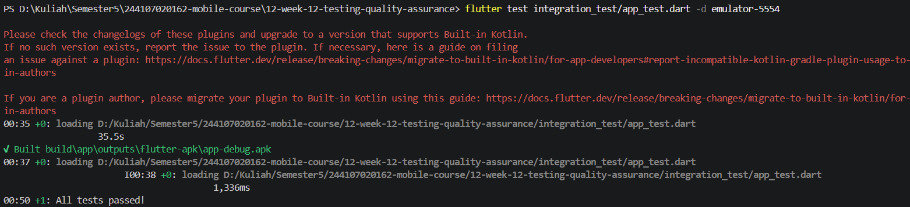
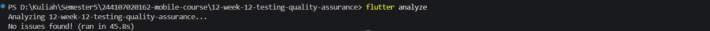

# 12 | Pengujian dan Jaminan Kualitas

---
## Skenario pengujian

| Jenis | Skenario | Hasil yang diharapkan |
|---|---|---|
| Unit | Judul `null`, kosong, atau hanya spasi | Validasi mengembalikan pesan error |
| Unit | Judul berisi teks | Validasi mengembalikan `null` |
| Unit | Query pencarian kosong/spasi | Semua catatan dikembalikan |
| Unit | Pencarian sebagian judul, beda kapitalisasi, atau spasi tepi | Catatan yang cocok ditemukan |
| Unit | Pencarian tidak menemukan judul | Hasil berupa list kosong |
| Unit + fake | Repository mengembalikan data | `GetNotes` meneruskan daftar catatan |
| Unit + fake | Repository gagal membaca data | Kegagalan diteruskan sebagai `Failure` |
| Unit + fake | `SaveNote` menerima judul kosong | Melempar `NoteValidationException` tanpa menyimpan |
| Widget | Halaman dibuka dengan catatan | Judul dan isi catatan terlihat |
| Widget | Belum ada catatan | Empty state ditampilkan |
| Widget | Form disimpan tanpa judul | Pesan validasi tampil dan repository tidak dipanggil |
| Widget | Form berisi judul dan isi valid | Catatan baru muncul pada daftar |
| Widget | Kata kunci pencarian dimasukkan | Daftar hanya menampilkan judul yang cocok |
| Widget | Repository gagal lalu dicoba ulang | Error tampil, lalu halaman dapat memuat ulang |
| Integrasi | Tambah catatan kemudian buka detail | Catatan muncul di daftar dan isi yang sama muncul di halaman detail |

---
## File test yang ditambahkan

- `test/support/fake_note_repository.dart` – fake in-memory untuk mengontrol
  hasil sukses dan kegagalan repository tanpa SQLite atau jaringan.
- `test/features/notes/domain/validate_note_test.dart` – pengujian validasi
  judul dan kasus tepi.
- `test/features/notes/domain/search_notes_test.dart` – pengujian fungsi
  pencarian judul.
- `test/features/notes/domain/get_notes_test.dart` – pengujian use case
  `GetNotes` dan `SaveNote` menggunakan fake repository.
- `test/features/notes/presentation/notes_page_test.dart` – pengujian widget
  daftar catatan, validasi form, penambahan, pencarian, dan penanganan error.
- `integration_test/app_test.dart` – pengujian alur dari tambah catatan
  sampai membuka halaman detail melalui router aplikasi.

Pada dialog tambah catatan ditambahkan `Key` untuk field judul, field isi,
serta tombol simpan supaya interaksi test dapat memilih kontrol secara stabil.

---
## Hasil menjalankan pemeriksaan

```bash
flutter test
flutter test --coverage
flutter test integration_test/app_test.dart -d <device_id>
flutter analyze
```

- Hasil flutter test:
    > 
- Hasil flutter test --coverage:
    > 
    > [Folder Coverage](coverage/lcov.info)
- Hasil flutter test integration_test/app_test.dart -d device_id:
    > 
- Hasil flutter analyze:
    > 

---
## Refleksi

- Bug apa yang paling mungkin terlewat tanpa pengujian yang Anda tulis?
  = Judul kosong atau hanya spasi dapat tersimpan bila validasi form terlewat.Pencarian juga berpotensi gagal untuk query dengan kapitalisasi berbeda, spasi di awal/akhir, atau kata kunci yang tidak memiliki hasil. Pada alur UI, perubahan data mungkin tidak langsung terlihat bila provider tidak dimuat ulang setelah catatan ditambahkan.

- Bagian mana yang perlu fake, dan bagaimana fake membantu konsistensi?
  = Akses data pada `NoteRepository` perlu diganti fake. Fake mengembalikan data yang telah ditentukan dan dapat dipaksa menghasilkan error, sehingga test tidak bergantung pada database, jaringan, API, autentikasi, atau data perangkat. Hasilnya lebih cepat, dapat diulang, dan tidak berubah karena kondisi layanan eksternal.

- Apa perbedaan nilai pengujian widget dan integrasi?
  = Pengujian widget memeriksa satu bagian UI dalam kondisi terkontrol, misalnya pesan validasi, empty state, atau hasil pencarian. Pengujian integrasi memeriksa beberapa bagian yang bekerja bersama: form tambah catatan, repository yang diinjeksi, daftar catatan, routing, dan halaman detail. Widget test lebih terarah untuk menemukan masalah tampilan/interaksi, sedangkan integration test memeriksa alur pengguna lintas komponen.
---